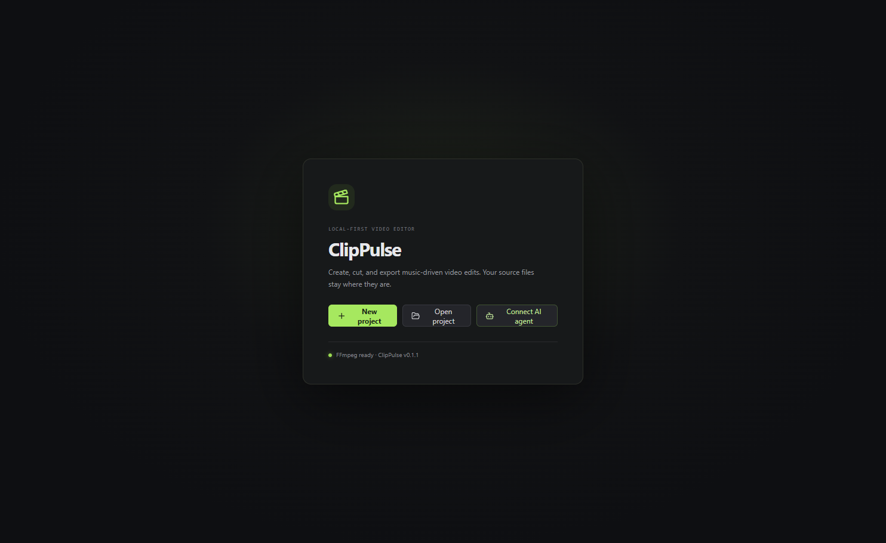

# ClipPulse

**AI-native video editing for gaming montages.** ClipPulse is a free, open-source desktop editor for arranging gameplay footage and music, refining the timeline by hand, and exporting MP4 videos. Codex and Claude Code can use the same editing core through MCP; CLI and local REST interfaces are also available.

“AI-native” describes how agents can inspect projects and call typed editing tools. ClipPulse does not include a hosted AI service or promise automatic understanding of every game. Media processing is local through FFmpeg, and agents only access the folders you grant.

[Install ClipPulse](INSTALLATION.md) · [Download beta builds](https://github.com/mulhans100-a11y/ClipPulse/releases) · [Connect an agent](MCP_SETUP.md) · [GPL-3.0-or-later](LICENSE)



*First-launch screen from the Windows x64 development build; the app displays version 0.1.1.*

## What is implemented

- A Windows desktop editor with a media library, source viewer, multitrack timeline, inspector, project save/recovery, and undo/redo.
- Video and audio import, search, tags, favorites, cached thumbnails and waveforms, plus local Medal capture-folder import.
- Timeline editing: move, trim, split, duplicate and remove clips; adjust transforms, color, opacity, audio, speed, fades, keyframes, titles, transitions, masks and chroma key.
- FFmpeg-based preview and H.264/AAC MP4 export. Projects refer to source media; they do not overwrite it.
- Local music analysis for estimated tempo, beats, downbeats, accents and energy sections. Auto-montage generation creates editable project variants in aggressive, cinematic, smooth, clean, velocity or custom styles.
- Local gameplay activity cues based on available audio, sampled motion, scene changes and optional OCR/HUD phrases. Results include evidence and uncertainty; they are suggestions, not confirmed gameplay events.
- Agent control through a versioned MCP tool catalog, a JSON CLI and loopback REST. These all call the shared `src/core` editing services.
- Optional local object-mask segmentation for supported COCO classes. The model downloads on first use; it is not bundled.

The [roadmap](ROADMAP.md), [CLI/API guide](API.md) and [agent API contract](AGENT_API.md) describe the available interfaces and their limits.

## Install

ClipPulse is in beta. Download the latest pre-release for your operating system from [GitHub Releases](https://github.com/mulhans100-a11y/ClipPulse/releases) and follow [INSTALLATION.md](INSTALLATION.md). Windows x64 is the locally verified desktop platform; Linux and macOS target-machine installation remain unverified. A successful package build alone does not establish that every package was installed and tested on a target machine.

**FFmpeg and FFprobe are separate requirements.** They are not bundled with ClipPulse. Install FFmpeg 6 or newer with the `drawtext` filter and `libx264` encoder, make both `ffmpeg` and `ffprobe` available on `PATH`, then restart the editor. See the installation guide if the runtime check reports a problem.

### Run from source (Windows PowerShell)

Requirements: Windows 10/11, Node.js 24+, npm 10+, Git, and compatible FFmpeg/FFprobe.

```powershell
git clone https://github.com/mulhans100-a11y/ClipPulse.git
cd ClipPulse
npm ci
npm run dev
```

Node.js and npm are only needed for the source checkout and CLI development. Installed desktop packages include Electron. For a source build, run `npm run build`; use `npm run cli -- doctor` to check the local FFmpeg runtime.

## Make your first edit

1. Create a project or open an existing `.omproj` file.
2. Import gameplay clips and music from files or a folder.
3. Add media to video and audio tracks, then arrange and trim the clips.
4. Use the preview and inspector to refine timing, effects and audio. Auto Edit can create editable montage variants as starting points.
5. Review the timeline and export an MP4. The export is validated before the destination file is finalized.

Projects keep paths to the original media rather than embedding it. Keep source files in place or relink them if they move. The Medal option reads a local capture folder; it does not connect to a Medal account or cloud service.

## Edit with Codex or Claude Code

Do the project setup once: open **Agent** in ClipPulse, choose Codex or Claude Code, grant access to the project, existing clip library, music and output folders, then run the connection check. Make sure the gameplay files are already imported into that project's media library. The setup flow preserves existing client configuration and saves a backup before updating it. Install and sign in to the AI client separately. The built-in setup currently targets Codex CLI and Claude Code; Claude Desktop has a separate setup flow and is not configured by this dialog.

For each new edit, the intended workflow is to provide the music file and describe the edit. The agent can import and analyze that music, search the existing project's media by its names, games or tags, analyze eligible videos, and generate a montage without asking you to choose clips one by one. The montage tool can consider all project videos when no video IDs are specified. The agent still needs the project path as context; ClipPulse does not yet expose an implicit “use whichever project is open in the desktop” MCP context. If the library or project has not been set up, the agent needs that location first.

Example request after connecting:

> Use `D:\Music\track.wav` and the existing project library to create a 30-second portrait, aggressive Valorant montage. Search the library and choose the best supported highlight cues yourself; do not ask me to pick individual clips. Align cuts to suitable music accents, add restrained zooms and speed ramps where useful, and create an editable project in my approved Exports folder. Validate and preview it, report uncertain event detections, then export `montage.mp4`. Do not modify the source media.

The agent can create and edit the project through ClipPulse’s tools; detected highlights and music timing are heuristic and should be reviewed. For exact setup steps, permission behavior and examples, see [MCP_SETUP.md](MCP_SETUP.md) and [AGENT_API.md](AGENT_API.md).

CLI example:

```powershell
npm run build
npm run cli -- create --project .\montage.omproj --fps 60/1
npm run cli -- import --project .\montage.omproj D:\Captures\Valorant
npm run cli -- inspect --project .\montage.omproj
```

The CLI reports media and track IDs. Use them with `clip-add` and `export`; use `generate-montage` to create editable variants. See [API.md](API.md) for complete command syntax and [AGENT_E2E.md](AGENT_E2E.md) for the reproducible synthetic agent workflow.

## Current limitations and beta status

- ClipPulse is early beta software. Review generated edits before publishing or sharing them.
- Music, motion, scene-change and HUD detections are signals and heuristics. They do not reliably identify every kill, headshot, clutch or musically ideal cut. There is no bundled trained gameplay-understanding model.
- HUD phrase detection requires optional Tesseract OCR. Segmentation supports common object classes; it may not isolate game-specific characters or arbitrary objects.
- Timeline playback renders a cached preview section before playback. It is not a real-time compositor, and edits can require a new section render.
- Export depends on the installed FFmpeg build, its filters/encoders and system resources. Optional GPU encoders depend on compatible drivers.
- Unsigned installers may trigger Windows SmartScreen or macOS Gatekeeper. The locally tested v0.1.2 Windows installer is unsigned; consult the versioned release-status file for the platform packages' signing status.
- The release build/test jobs have run on Windows x64, Linux x64, macOS arm64 and macOS Intel. Target-machine installation is verified on Windows x64 only; Linux/macOS installations are unverified. A historical Codex CLI agent run is recorded in the [test report](AGENT_TEST_REPORT.md); the latest connection-onboarding check covers MCP initialization and a harmless tool call, not a fresh authenticated agent turn. Claude Code host testing is not claimed for the current environment.

## Development and documentation

```powershell
npm run dev
npm run build
npm test
```

The automated suite uses generated synthetic media; it does not require your gameplay recordings or music. See the [test report](AGENT_TEST_REPORT.md) for environment-specific results and untested clients/platforms.

| Guide | Contents |
| --- | --- |
| [Installation](INSTALLATION.md) | Installers, source setup, FFmpeg and troubleshooting |
| [Architecture](ARCHITECTURE.md) | Shared core and app structure |
| [CLI and API](API.md) | Command-line and local service operations |
| [Agent API](AGENT_API.md) | Versioned MCP, REST and tool schemas |
| [MCP setup](MCP_SETUP.md) | Codex and Claude Code configuration and permissions |
| [Agent E2E](AGENT_E2E.md) | Synthetic workflow and optional local-media run |
| [Gameplay analysis](GAMEPLAY_HIGHLIGHTS.md) | Signals, confidence and evaluation limits |
| [Quality control](QUALITY_CONTROL.md) | Reports and bounded automatic corrections |
| [Timeline preview](TIMELINE_PREVIEW.md) | Preview cache and measured performance |
| [Contributing](CONTRIBUTING.md) | Local workflow and contribution expectations |
| [Security](SECURITY.md) · [Dependencies](DEPENDENCIES.md) | Security reporting, bundled notices and media/codec notes |
| [Demo-video storyboard](DEMO_VIDEO_SCRIPT.md) · [GitHub metadata proposal](GITHUB_REPOSITORY_METADATA.md) · [v0.1.1 release-description draft](V0.1.1_RELEASE_DRAFT.md) | Maintainer publication materials; no release or repository setting is changed by these files |

ClipPulse is distributed under [GPL-3.0-or-later](LICENSE). Bundled dependency notices are documented in [DEPENDENCIES.md](DEPENDENCIES.md); FFmpeg itself is installed separately.
